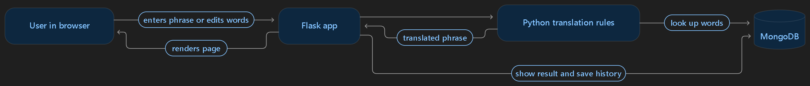

# Design
## Project Ideas
* coupon/deal finder
* choose your own adventure game
* **Faeric language translator**
* translator?

### Interests
* Superheroes
* Star Wars
* Harry Potter
* Drawing
* Reading
* Movies
* Video Games
* Music
    * Listening
    * Piano
    * Ukulele
* Board Games+
    * DND
        * Faeric language translator
    * MTG
    * Villainous

## Pitch
### Faeric Language Translator/Language Builder
I have the beginnings of an original language I created for DND. This project can serve as a way to flesh it out, and create a translator app that can take simple English and translate it into Faeric, and vice versa.
### Questions to answer
1. Why are you interested in this project?
    - I am excited to work more on projects related to my homebrew DND world.
    - I believe this can be applied to other original or spoken languages.
2. What problem does your project solve, or what becomes better for having it?
    - The project will provide an efficient and quick means of translating words or small phrases, instead of me having to scroll my google doc.
3. What technologies are you considering to use?
    - Python: translation, tokenization, word lookup, grammar application
    - Flask: Web Interface?
    - MongoDB with PyMongo: persistent data storage (lexicon, language rules, translation history)
    - HTML + CSS: UI
    - GitHub: repo and final report.

## Diagram

# Future Codex Prompts
I have a custom font .otf file saved to sources, this holds the alphabet. There is also a pdf file called faeric-runes.pdf in sources that holds what I have already defined for the language.