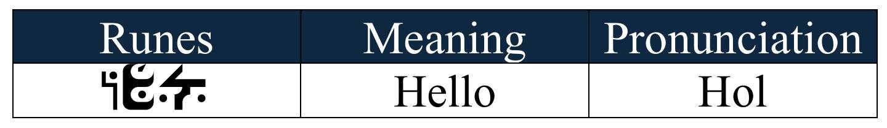
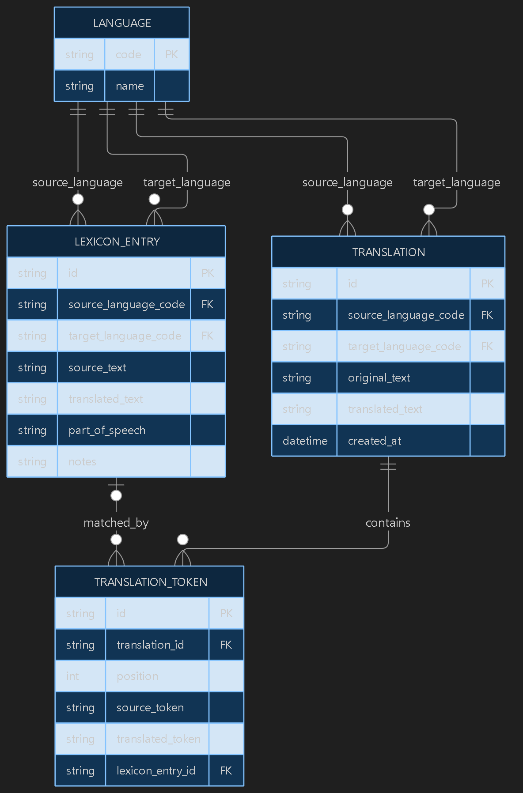
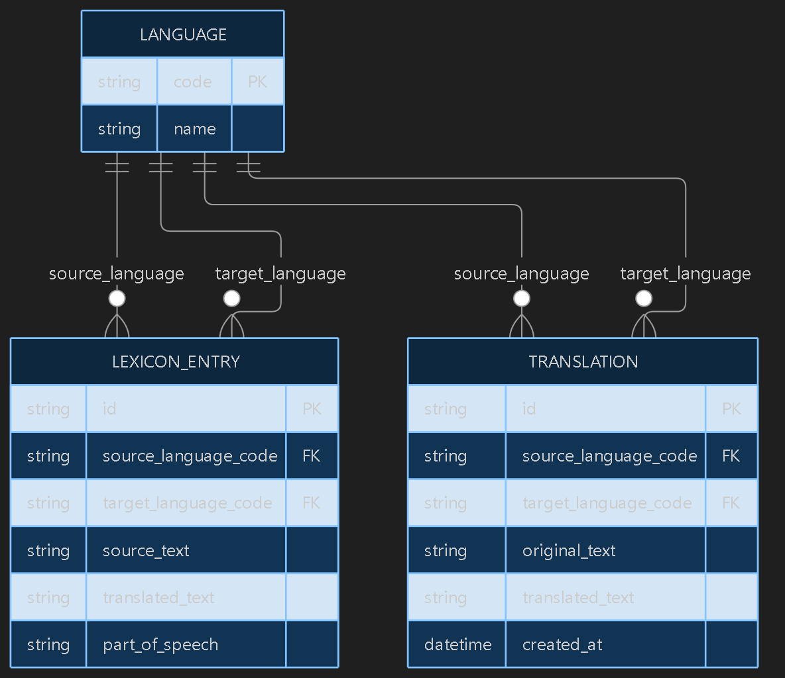
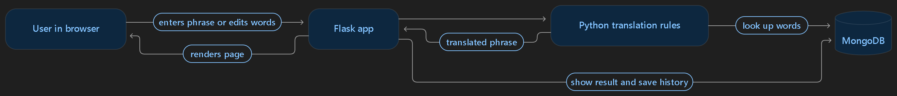
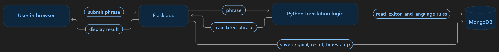
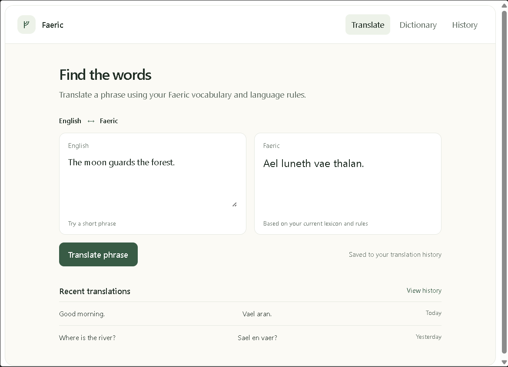

# Design
## Summary

I have the beginnings of an original language I created for DND. This project can serve as a way to flesh it out, and create a translator app that can take simple English and translate it into Faeric, and vice versa.

The project will provide an efficient and quick means of translating words or small phrases, instead of me having to scroll my google doc.

Hello

To and from   
Travel  

### Technologies:
- Python: translation, tokenization, word lookup, grammar application
- Flask: Web Interface?
- MongoDB with PyMongo: persistent data storage (lexicon, language rules, translation history)
- HTML + CSS: UI
- GitHub: repo and final report.

### Security Boundaries
**Browser -> (Flask?) App -> MongoDB**  
* Browser is user-controlled.
* (Flask?) App is the gatekeeper
* MongoDB should only accept connections from the app
* Keep MongoDB URI and (Flask?) App secret key... secret
* app's MongoDB user accesses only the project database with needed permissions (also restrict which network sources can reach the cluster)
* Treat submitted phrases and dictionary edits as untrusted input: set sensible length limits, validate fields, and escape text shown in the page.

### Scaling Considerations
* Avoid querying MongoDB once per word. Load the lexicon for a translation in one query, or cache it briefly.
* Index the normalized word field used for lookups; make it unique if each language entry should have only one matching record.
* careful with app state

### Costs
* MongoDB free tier
* Render.com has free web services
* Flask is free...

## ERD

### With grammar in database

### Without grammar in database

## System Design Diagrams

### With grammar in database

### Without grammar in database

## Daily Goals
* 1-2 hours of work per day
* end each day with something new and/or functional commited

## UX
