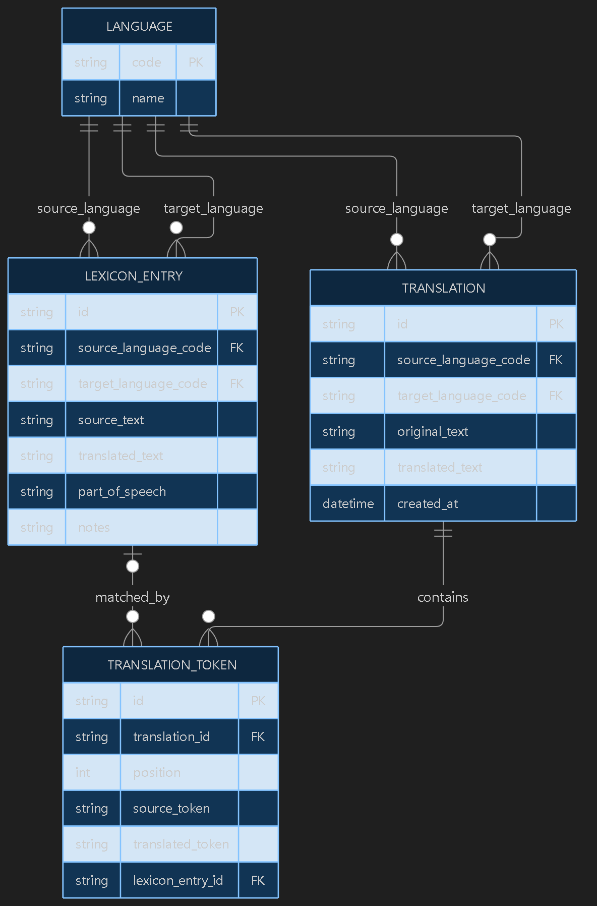
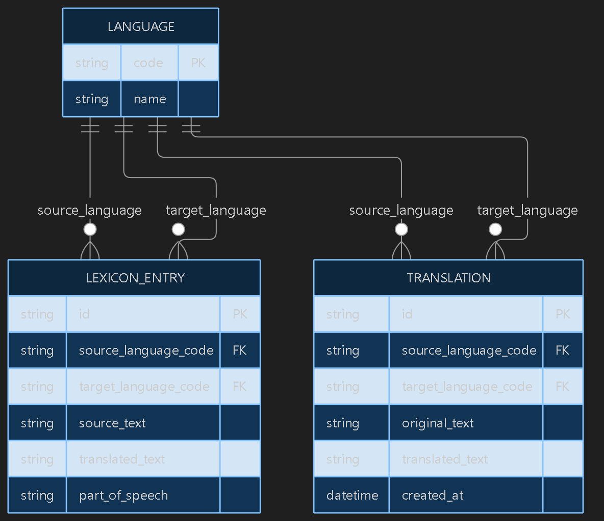
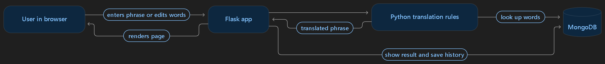
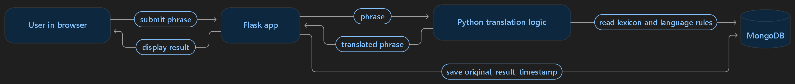
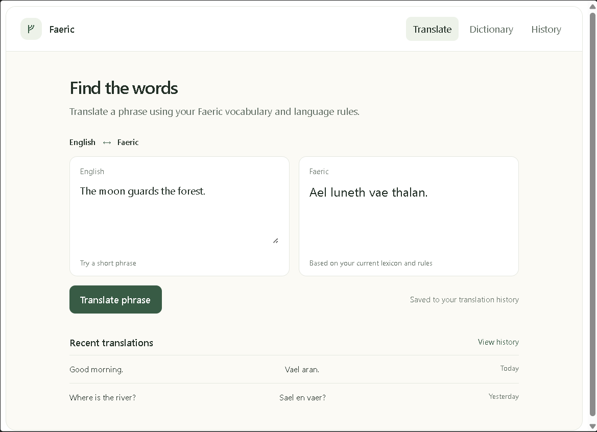

# Design
## Summary

I have the beginnings of an original language I created for DND. This project can serve as a way to flesh it out, and create a translator app that can take simple English and translate it into Faeric, and vice versa.

The project will provide an efficient and quick means of translating words or small phrases, instead of me having to scroll my google doc.

Hello

To and from   
Travel  

### Technologies:
- Python: translation, tokenization, word lookup, grammar application
- Flask: Web Interface?
- MongoDB with PyMongo: persistent data storage (lexicon, language rules, translation history)
- HTML + CSS: UI
- GitHub: repo and final report.

### Security Boundaries
**Browser -> (Flask?) App -> MongoDB**  
* Browser is user-controlled.
* (Flask?) App is the gatekeeper
* MongoDB should only accept connections from the app
* Keep MongoDB URI and (Flask?) App secret key... secret
* app's MongoDB user accesses only the project database with needed permissions (also restrict which network sources can reach the cluster)
* Treat submitted phrases and dictionary edits as untrusted input: set sensible length limits, validate fields, and escape text shown in the page.

### Scaling Considerations
* Avoid querying MongoDB once per word. Load the lexicon for a translation in one query, or cache it briefly.
* Index the normalized word field used for lookups; make it unique if each language entry should have only one matching record.
* careful with app state

### Costs
* MongoDB free tier
* Render.com has free web services
* Flask is free...

## ERD

### With grammar in database

### Without grammar in database

## System Design Diagrams

### With grammar in database

### Without grammar in database

## Daily Goals
* 1-2 hours of work per day
* end each day with something new and/or functional commited

## UX

### Ideas
* [x] Add edit button for dictionary entries
* [x] Multiple English words mapping to one Faeric word
* [x] Multiple Faeric words mapping to one English word
* [ ] Dictionary search by Faeric pronunciation

### Artistic renders
* Include options for rendering translations into cool pictures?
* CS355 graphics type stuff?
* Example: rock image in source files

### DND Player Page
* how proficient is your character?
* use a metric to determine how much a person could use

# Scaling and End Goal
## Online Deployment
* only allow 5 unapproved suggestions to be sent by an individual user, the rest are saved on the account until the others are approved
* throw unapproved suggestions on a queue or something similar for the admin (me) to access and approve
    - asynchronous queue
* approved suggestions should propogate to all users

## Local Use
* spend time  adding to local dictionary in app to flesh out Faeric as much as possible
    - Options to add to lexicon: 
        - Key: ~~not included~~, *root word included*, **included**
        - 1 Nephi 1: 
            - ~~Nephi~~, *having*, *been*, *born*, *goodly*, *parents*, ~~therefore~~, *was*, *taught*, ~~somewhat~~, **in**, **all**, *learning*, **my**, **father**, *seen*, **many**, *afflictions*, **course**, *days*, ~~nevertheless~~, *highly*, *favored*, **Lord**, **yea**, *had*, **a**, **great**, *knowledge*, *goodness*, *mysteries*, **God**, **make**, *record*, ~~proceedings~~
        - With great power, there must also come great responsibility:
            - **power**, **there**, **must**, **also**, **come**, *responsibility*
        - In brightest day, in darkest night, no evil shall escape my sight. Let those who worship evil's might, beware my power: Green Lantern's light!
            - *brightest*, *darkest*, **evil**, ~~shall~~, **escape**, *sight*, **Let**, *those*, **worship**, *might*, **beware**, **Green**, **Lantern**
        - colors:
            - **red**, **orange**, **yellow**, **green**, **blue**, **purple**, **pink**, **white**, **grey**, **black**, **brown**
        - According to all known laws of nature, there is no possible way that a bee can fly
            - ~~According~~, *known*, *laws*, *nature*, *is*, **possible**, **way**, that, **bee**, **can**, **fly**
        - **dictionary**
        - There once was a man, a very rich man, he had a lot of sheep, he had a lot of ram
            - once, *was*, *man*, +
            **rich**, *had*, *lot*, **sheep**, **ram**

* include translation rules
    - [x] possessive s "steven's sandwich"
    - [x] modifiers: "-er", "-est"
    - [x] something to detect past/future tenses of words already in dictionary
    - [ ] **me**/myself/I, **you**/yourself, **they**/themself/them, *he*/himself, she/herself
    - [ ] ***suggested translations for words not in the dictionary***
    - Conjugation Rules: 
        - Add pronoun to the beginning of the verb. 
        - Present = “u” + pronoun + verb 
        - Past = pronoun + word + “n” 
        - Future = pronoun + word + “m” 
        - end: -are, -ere, -ire, -ore, -ure
    - only long vowels
    - English short vowels -> eliminated or replaced with glottal stop marked by an apostraphe
    - English to Latin/Spanish then apply rules. Then mangle
* UI: Sun & Moon or White vs. Black Sun

## End Goal
Something *I* can pull up and use without needing to run it locally.
* Doesn't need to be public
* Doesn't need to be hosted online